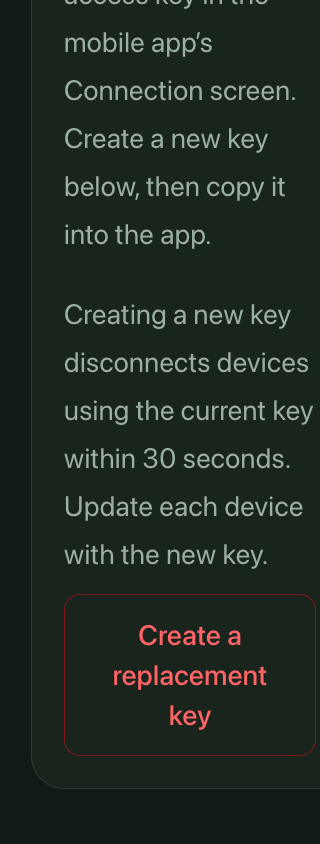
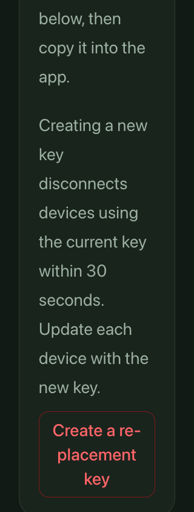
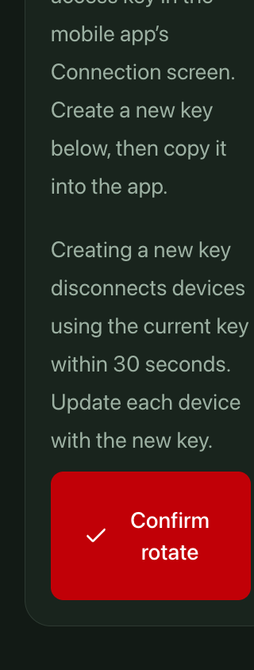
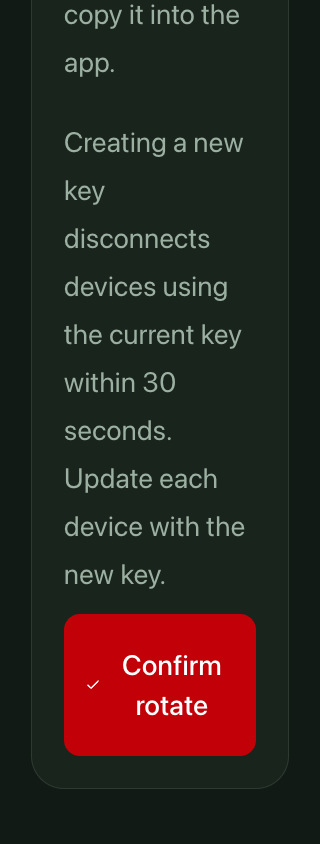
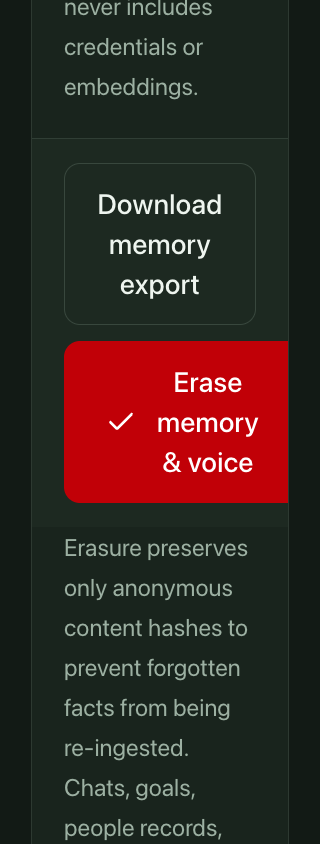
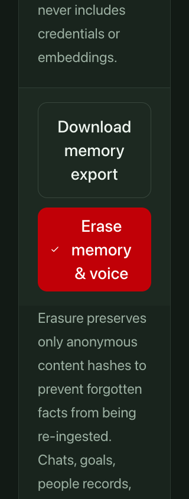

# Card action containment — October 20, 2026

This isolated candidate starts at main `c790625c`. It changes only the Settings mobile-key consumer and the privacy-controls consumer. The shared menu candidate `69689323` and all earlier candidate heads remain untouched.

## Confirmed parent-layout failure

Long standalone labels themselves remain readable in the checked Security recovery control. The separate failure is intrinsic sizing inside cards: mobile-key and privacy forms can exceed their available content width at 320px with root text doubled to 32px.

Two baseline contexts must remain distinct. The original isolated MobileTokenPanel/Card fixture has a Card ending at 288px, while the control extends to 316.45px and the warning clips at the Card edge. The source-faithful Settings composition adds the actual PageShell grid, header and section structure: there the automatic outer grid track grows the Card to 348.45px, beyond the main content ending at 288px. The warning fits that expanded Card but crosses the main gutter. The privacy Card remains 32..288px while its control ends at 304.05px. Independent QA reproduced the pre-existing issue on both main and the menu candidate; it is not a menu regression.

## Bounded repair

The mobile action group has an explicit, shrinkable grid track. Both forms allow shrinking and stay within their parent's width; long words no longer force their intrinsic minimum wider than the card. Browser hyphenation provides readable breaks for the long resting label while preserving its original text.

Below the existing `md` breakpoint, only these forms cap the Tailwind spacing unit at its normal 4px value. This caps decorative button insets, gaps, icon dimensions and minimum dimensions while text continues to follow the root font size. At `md` and wider, the original relative spacing unit is restored. The declaration is inherited only by form descendants; it does not change the card's warning, other controls or global styling.

At the enlarged narrow profile, text remains 28px, the button's horizontal/vertical padding is 20px/10px, the check icon is 16px and the rotation/privacy controls are 142px tall. All measured hit areas remain at least 44px. At 1280px with the same enlarged text, computed horizontal/vertical padding returns to 40px/20px and the icon returns to 32px. These are executed measurements, not an assumption based on the breakpoint class.

The full copy, two-step confirmation, expiry, focus behavior, pending/disabled logic, action callbacks, authorization and API policy are unchanged. Shared UI primitives and global CSS are byte-identical to main. The production diff contains class attributes and explanatory JSX comments only.

## Executed evidence

The [verification receipt](assets/card-containment-2026-10-20/verification.json) records the same final harness and exact source hashes for 14 archived-main cases and 14 fixed cases, with 40 original PNGs per series. It covers existing-key rotation, unconfigured-key creation, privacy erasure and a Security recovery reference at normal/enlarged narrow and normal/enlarged desktop sizes.

The fixed source-composed Settings Card is exactly 32..288px inside the main gutter; its warning and controls stay within the 64..256px content area. All rendered paragraph lines, the full visible label and all three reserved confirmation labels fit. The whole existing-key warning is reachable in a vertical-only reading view. Every ancestor horizontal offset remains zero: the test does not repair clipping with scripted horizontal scrolling.

Real pointer first-arm and native Tab/Return first-arm preserve the exact target rectangle. Escape restores the resting label. No second confirmation or action callback runs. The reserved pending copy is measured, but an actual pending write is not exercised.

Normal 390px and both 1280px profiles preserve recorded geometry, text and computed insets; their 20 checked resting/armed image pairs are byte-identical to the baseline. This includes the `md` restoration at enlarged desktop text. The unrelated Security recovery reference remains unchanged.

Local lint, typecheck and 53 existing source-fixture tests pass. Independent final-source QA/review and exact-head CI remain separate gates.

| Example | Before | After |
| --- | --- | --- |
| Enlarged Settings warning and control |  |  |
| Enlarged rotation confirmation |  |  |
| Enlarged privacy confirmation |  |  |

[Resting key label before](assets/card-containment-2026-10-20/before-mobile-rest.png) · [Resting key label after](assets/card-containment-2026-10-20/after-mobile-rest.png) · [Unconfigured-key keyboard confirmation](assets/card-containment-2026-10-20/after-create-keyboard.png)

## Scope and replay

These fixtures use actual components in the current Settings/Data visual composition with synthetic props and forbidden server-action modules. They do not execute an authenticated route, rotate a key, erase data, contact a provider, exercise real pending completion, or certify native/production behavior. The Recovery control is a representative exact control rather than the complete SecurityClient. Root-font scaling is distinct from browser zoom. Hyphenation is observed in this Chrome environment and can vary by browser/language support.

Replay with `pnpm exec tsx scripts/card-action-containment-qa.ts <fresh-output-directory>`. The `--before` mode expects historical containment failure and must run against the recorded archived main inputs. Final full observations and images are `.workspace/card-containment/{baseline-verified,final-verified}`. Earlier isolated evidence remains separately preserved under the designer and independent QA monitor directories; exploratory locator/measurement-helper runs are excluded from this receipt.
