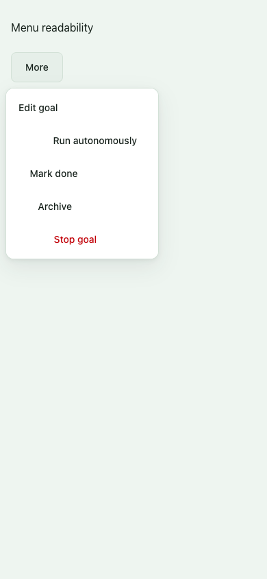
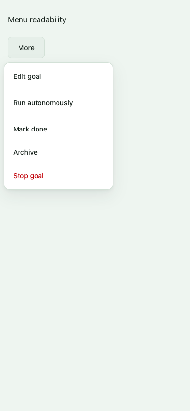
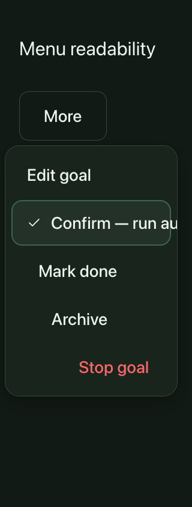
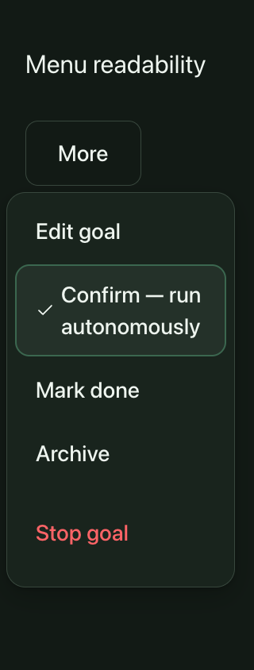
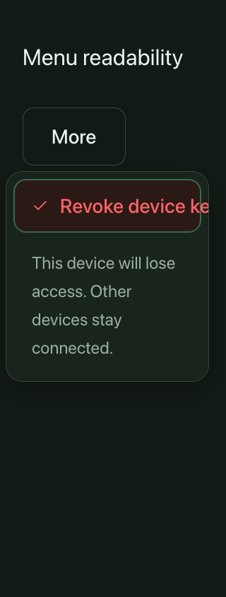
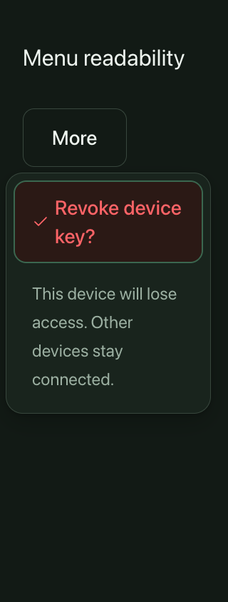

# Menu confirmation readability — October 20, 2026

This isolated candidate starts at main `c790625c`. It changes shared menu presentation in two files; earlier conversation, loading, passage and upload candidate heads remain untouched.

## Confirmed failure

The shared menu row forced one line and a fixed height, while ConfirmButton reserved its longer safety copy in an unconstrained, centered grid. In the Goals menu, first activation clipped “Confirm — run autonomously” even at normal text size. At 320px with root text doubled to 32px, its rendered label extended to 443.56px beyond a panel ending at 296px. The original panel had 435px of content inside a 286px client width. The resting action also clipped at enlarged text. Other menu actions were centered despite the menu primitive's intended left alignment.

An initial read-only series captured eight settled normal/enlarged/theme profiles, including pointer first-arm and native keyboard first-arm/Escape, without confirming an action. That baseline is preserved in the designer QA evidence directory. The final reusable harness additionally reproduces the long-label issue with the actual Security passkey/device confirmation variants against archived main inputs.

## Presentation repair

Menu rows now grow vertically and wrap within their existing panel width. Their label grids and all three reserved confirmation stages are bounded. Menu variants align to the start; regular standalone confirmation markup and centering remain unchanged. Icons retain their size instead of shrinking to accommodate text. The decorative icon/text gap keeps its normal 8px size as text enlarges, allowing the full autonomy label to fit in two lines without breaking its final letter onto another line.

Buttons reserve the full resting, confirmation and pending labels before activation, so arming does not move or resize the target. Menu height can increase to accommodate that copy. The second-confirmation handler, eight-second expiry, blur/Escape reset, pending/disabled behavior and native popover placement code are unchanged. Meaningful safety labels are preserved verbatim.

## Executed evidence

The [verification receipt](assets/menu-readability-2026-10-20/verification.json) records source/harness hashes and measured text lines. The exact same final harness runs 23 cases against the archived main source and 23 against the candidate, with 38 original PNGs per series:

- Goals, passkey removal and device-key revocation at 390px/root 16px and 320px/root 32px, in both themes: resting, pointer first-arm, native keyboard first-arm and Escape focus return.
- Representative Goals/Security pending and disabled props at normal and enlarged text. These are synthetic props, not writes triggered by a second confirmation.
- Two regular standalone Delete controls: all recorded geometry, text, reserved-label bounds and focus state match the baseline exactly.
- A low-positioned Goals invoker: the existing upward placement remains within the viewport.

All final visible text lines and all three reserved labels fit their control bounds; menu content no longer needs horizontal scrolling. First activation preserves the exact button rectangle. The autonomy control is 56px tall at normal text and 112px with doubled text, with the same dimensions before and after arming. The check icon remains 24px. Goal blur resets the first-stage confirmation; native Escape closes menus and returns focus to their invokers. Pending and disabled controls remain unavailable. No second confirmation or action callback is executed.

The ConfirmButton event-handler block and the entire ActionMenu placement component are byte-identical to main. Local lint, typecheck and 53 existing source-fixture tests pass. Independent runtime QA, source review and final-head CI remain separate gates.

| Example | Before | After |
| --- | --- | --- |
| Normal menu alignment |  |  |
| Enlarged autonomy confirmation |  |  |
| Enlarged Security device confirmation |  |  |

[Pending passkey control](assets/menu-readability-2026-10-20/after-passkey-pending.png) · [Disabled passkey control](assets/menu-readability-2026-10-20/after-passkey-disabled.png)

## Limits and replay

These are actual shared React controls and compiled CSS in representative wrappers using the exact Goals/Security labels. They do not render complete authenticated pages, execute production goal/device/passkey actions, exercise a real pending write, or certify native/device/production behavior. Security's icon invoker is represented by a text invoker; placement logic is retained and tested with representative positions. Root text scaling is distinct from browser zoom. Initial fixture transpiler-helper and device-copy mismatches were corrected before the final series; exploratory runs are excluded.

Replay with `pnpm exec tsx scripts/menu-readability-visual-qa.ts <fresh-output-directory>`. The `--before` mode expects historical clipping and must run against the recorded archived main inputs. Full final observations and PNGs remain under `.workspace/menu-readability/{baseline-final,final-gap}`. The earlier eight-profile settled baseline remains at `/Users/baldvinsmarason/.codex/qa-monitors/designer/goal-menu-readonly-2026-10-20/`.
