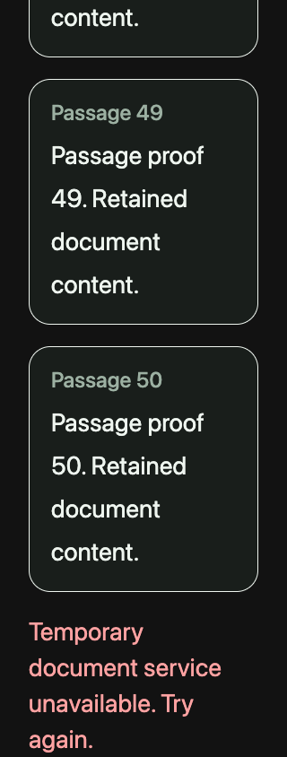
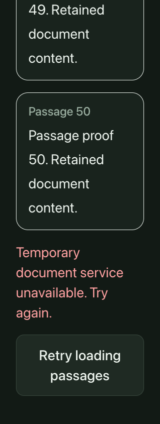
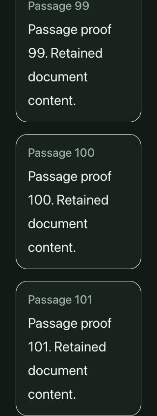

# Document passage recovery — October 20, 2026

This independent candidate starts from main commit `c790625c`. It has no dependency on the conversation or loading-layout patches in PRs #621 and #622.

## Confirmed usability failure

On Documents, the first page of passages can load successfully and a later page can fail. The error previously removed Load more. Hiding and reopening the passages did not fetch again because the existing passage list was nonempty. Readers could see the failure but could not retry or continue without reloading the page.

The same final browser harness reproduces that dead end on the archived main source in four profiles: 390px with root 16px, and 320px with root 32px, both light and dark. After a local GET at cursor `0` succeeds and cursor `50` fails, Hide/Read leaves the request trace at `[0, 50]` with only the Hide passages button available. This is controlled component evidence, not a production incident claim.

## Bounded repair

The existing page cursor remains the retry destination after an ordinary failure. An explicit Retry loading passages button stays beside the readable error and describes that error accessibly. Loaded passages remain available. A successful retry advances the cursor normally and clears the error. Hide/Read retains this recovery path; first-page failures can also recover by reopening.

A synchronous in-flight guard prevents repeated activations or Hide/Read from starting overlapping requests. The existing changed-document conflict still clears stale passages and resets to cursor zero; its message now points to Retry. API admission, server pagination, storage, response policy, loaded-page styling and the separate upload flow are unchanged.

## Executed evidence

The [receipt](assets/passage-recovery-2026-10-20/verification.json) contains source hashes, the shared before/after harness hash and every request trace. The final 16 browser cases cover four scenarios in the four normal/enlarged theme profiles:

- Numeric pagination: `0 → 50 failure → 50 retry success → 100`, retaining the first 50 passages and ending with 101 unique passages.
- First-page failure: retrying zero successfully loads the first 50 passages.
- A changed-document conflict: stale passages clear and recovery requests zero.
- An opaque continuation cursor: retrying the exact encoded cursor completes one fragmented passage without duplicate text.

Actual native Tab/Return reaches and activates Retry in the retained numeric and opaque paths. The error is linked to that control. Held responses check that repeated activation and Hide/Read add no request while pending; disabled-control DOM events are a separately identified synthetic probe. Each final error view captures the actual Retry control within the viewport. Successful retry clears the error; subsequent pagination retains earlier text without duplicate headings.

| Before: dead end | After: retry available | After: continued reading |
| --- | --- | --- |
|  |  |  |

Local lint, typecheck and 54 existing passage-state/product-fixture tests passed. Independent QA and final-head CI remain separate gates. This matrix uses the actual React component, real compiled stylesheet and root main-container classes with loopback GET responses. No authenticated route, owner account, provider, database or storage write is exercised. It does not claim native or deployed behavior.

Replay with `pnpm exec tsx scripts/document-passages-visual-qa.ts <fresh-output-directory>`. The `--before` mode expects the historical dead end and must run against the recorded baseline component. Full images and observations remain in `.workspace/passage-recovery/{before-visible-retry,after-visible-retry}` in the isolated checkout. Intermediate exploratory harness runs are excluded.
