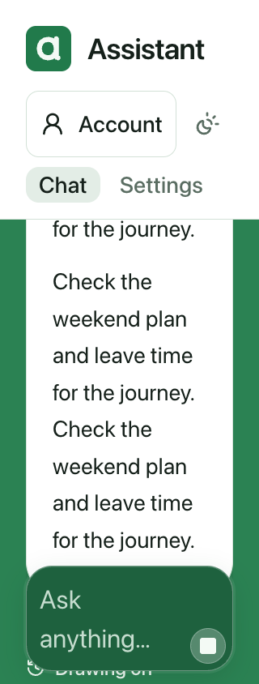
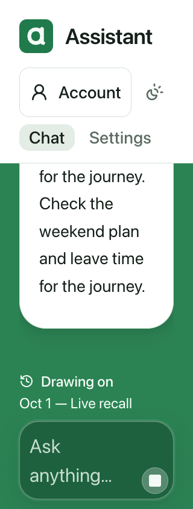

# UI consistency review — October 20, 2026

This continues the [34-route review](ui-consistency-2026-10-19.md). The scope is consistency and simplicity: preserve the existing green materials and system typography, keep text readable, and let controls reflow without losing their meaning. No new routes or native source changes are introduced.

The earlier navigation/title checkpoint is commit `bd29cd29` and is handled separately by QA/Cleaner. This follow-up remains a candidate until independent runtime review completes; it is not a deployment or whole-app accessibility certification.

## Findings addressed

| Priority | Condition | Repair |
| --- | --- | --- |
| P2 | At 320px with doubled root text, decorative transcript padding and oversized composer chrome could exceed the space below the headers. Primary and side chats could make the document taller than the viewport. | Bound decorative padding, keep text scaling, retain a measured composer, and make the navigation row horizontally scrollable when labels no longer fit. Text, selected values and actions retain their normal font size. |
| P2 | A floating Jump to latest pill covered much of a short side-chat reading area. | Put its existing arrow action beside the composer controls, with the same accessible name and an explicit button type. Keyboard/assistive activation transfers focus to Message; pointer activation does not programmatically focus the field. Drafts remain unchanged. |
| P2 | Physical maximum scroll could show trailing Copy/time/footer space while the actual latest reply ended above the reading window. | Explicit Jump and pinned following align the latest meaningful text above the composer. The pin calculation recognizes that reading endpoint as well as physical maximum. |
| P2 | Growing a long draft could be mistaken for the owner deliberately scrolling away before the form observer updated. | Preserve an already-pinned endpoint when the textarea's effective height changes. Keep deliberately scrolled-away ownership separate. |
| P2 | A bubble-only scroll target could miss card-only replies, cards after prose, and images after a heading. | Use the existing complete message-row boundary and explicit standalone reading blocks. Meaningful media later than text receives its own endpoint. |
| P2 | Live recall appeared after the message row, outside the semantic reading boundary, and could remain below the composer during streaming or Jump. | Mark only the nonempty standalone live-recall wrapper as a reading block; nested historical recall stays within its complete message row. |
| P3 | Upload controls, search fields, fact prominence options, disclosure counts, map filters and status rows could overflow compact layouts or enlarged text. | Bound fields to their parent, constrain grid tracks, and allow related labels/actions to wrap. Uploads and optional labels share the same bounded form geometry. |
| P3 | Compact schedule cards squeezed a fixed-width clock lane beside their descriptions, and header truncation hid their names. | Stack time and description below the small-screen breakpoint; retain two columns on wider screens. Card-shell headings wrap. |

## Intentional visual and interaction changes

Loaded conversation spacing changes from 80px to a bounded 24px reading inset. Transcript and composer fades are removed; the existing opaque composer well separates editing from reading. This makes required text use the available window instead of fading it under an overlay.

The composer keeps its existing normal-size icon-control dimensions and caps their enlarged size at 44px. Its decorative insets stay 8px. The textarea's existing 160px height ceiling now also applies when root text grows; longer drafts use the native textarea scroll area. Text itself remains enlarged. The normal and enlarged appearances require separate review because these are deliberate design changes, not solely invisible geometry repairs.

Navigation retains visible route labels. When those labels exceed the row, native horizontal scrolling and keyboard focus reveal the remaining destinations. Padding around the scrolling row preserves visible focus outlines. The 320px normal-size layout still fits its four links on one row.

## Reading boundary and renderer coverage

The latest `[data-message-block]` is the semantic response boundary. It contains ordinary and split prose, notifications, notices, approvals, budget requests, suggestions, approval summaries, specialized/generated response cards, off-course cards and action chips. The helper no longer guesses the latest response from a list of bubble classes.

Copy/time controls and CardSteps carry a utility marker so their whitespace or labels do not become the Jump destination. They remain in the DOM, scrollable, focusable and operable; the marker changes no visibility. Standalone turn feedback and the empty-chat invitation have explicit reading-block markers.

The endpoint uses actual rendered reading text, or meaningful image/chart/media that follows it. Text keeps a 16px clearance above the composer. A final visual receives 8px; when it exceeds the reading window, Jump reveals its lower region and the rest remains available through normal transcript scrolling. The helper inspects the latest semantic block, not every message's text.

## Executed evidence and limits

The [portable verification summary](assets/ui-consistency-2026-10-20/verification.json) records immutable capture inputs, per-state checks, source-hash qualification and the local-only I/O boundary. Full original receipts and screenshots remain under `.workspace/ui-review-2026-10-20/` in the review worktree.

| Series | Executed result | Qualification |
| --- | --- | --- |
| `pin-growth-large` | Eight primary/side, loaded/empty, light/dark states; 40 PNGs. Real pointer/keyboard Jump and composer-growth checks passed. | Executed before the final media-only endpoint refinement. |
| `generated-large-v2` | Eight states / 40 PNGs; latest assistant has a generated card without a prose bubble. | Independent unique newest-fact oracle; fixture chronology and preview visibility are explicit. |
| `agenda-large` | Eight states / 40 PNGs; specialized Agenda uses the normal CardShell path. | Covers compact stacked schedule rows and wrapped headings. |
| `image-large-final` | Eight states / 40 PNGs; initial delayed-image following, real pointer/keyboard Jump and post-growth media visibility passed. | These captures match the earlier frozen candidate `6726e529`, not the live-recall follow-up head. Four image reads are fulfilled by a local SVG fixture; no remote image is fetched. |
| Focused repository checks | Lint and typecheck passed; 199 rendering/navigation/provenance tests plus seven portable-log/feedback tests passed. | Full-suite/CI and independent final-source runtime review are separate gates. |

Every hydrated acceptance profile checks all actual rendered text-node lines through the reading window, not just a bubble rectangle. Required content must exist. It captures the top, a reachable final-content position, the native draft beginning/end, and settled outcomes of real pointer and keyboard Jump. Long drafts have distinct beginning/end markers. The keyboard checks reach both endpoints, retain the caret, and leave Send visible and enabled. Unexpected actions, sends and external requests fail the harness. The explicit streaming-recall profile permits only its validated synthetic Send to a local controlled SSE server; it makes no provider call, owner read or live owner send.

Actual Jump outcomes have no harness scroll correction. The independent oracle checks final reply text, the unique newest generated/schedule fact, or the loaded image region. A representative enlarged side-chat image run leaves a 60px reading window while editing; more than 48px of the actual image is visible there after each real Jump. The whole image remains scrollable.

The earlier route-wide source-component matrix and console checks are recorded in the October 19 review. Their retained captures do not silently become current when a shared input changes. Independent QA is checking the frozen follow-up source; the work remains unmerged and undeployed until the integration process accepts it.

The local native attempt compiled but could not launch tests because of simulator service failure. Native presentation work and its separate CI results belong to the Reviewer/QA workflow; this document does not turn a web fixture or compilation into native interaction evidence. Authenticated live routes, actual browser zoom, mobile software-keyboard behavior, physical gestures, voice and live integrations remain distinct from these synthetic root-text/browser checks.

## Streaming recall follow-up

The same final harness fails against archived commit `6726e529` before the wrapper fix: the Live recall line ends at 874.25px, below the composer at 698px. With the narrow fix, both `live-recall-final-large` (320px / root 32px) and `live-recall-final-normal` (390px / root 16px) pass all eight main/side, loaded/empty and light/dark states: 64 original PNGs per profile. These are the current-source captures; earlier source hashes remain qualified as earlier evidence.

The real AI SDK consumes a local controlled stream with an `x-recall` header. While the stream remains open, the note is readable at the pinned endpoint. A real wheel scroll to the beginning remains at zero through additional streamed text; actual pointer and keyboard Jump, subsequent pinned continuation, long-draft editing and completion pass. Each profile makes eight strictly validated local synthetic sends and zero provider calls or live owner sends. This proves client streaming behavior, not live route admission.





Independent QA separately confirmed delayed-image settling and deliberately scrolled-away ownership on the prior frozen head. No media observer change was needed. The live-recall follow-up requires its own independent review and fresh CI after publication.

## Replay

```sh
pnpm exec tsx scripts/product-visual-qa.ts .workspace/review-products --require-current
pnpm exec tsx scripts/product-visual-qa.ts .workspace/review-narrow --narrow --require-current
pnpm exec tsx scripts/product-visual-qa.ts .workspace/review-large --narrow --large-text --require-current
pnpm exec tsx scripts/product-visual-qa.ts .workspace/review-chat --hydrate-chat --long-chat --require-current
pnpm exec tsx scripts/product-visual-qa.ts .workspace/review-chat-large --hydrate-chat --narrow --large-text --require-current
```

For independent response-shape checks, add `--chat-card=only`, `--chat-card=with-prose`, `--chat-card=agenda` or `--chat-card=image` to a hydrated run and use a fresh output directory. Enlarged static product coverage explicitly excludes conversation; its settled geometry and scrolling require the hydrated series.

For controlled streaming recall, add `--stream-recall` to a hydrated run. This profile exercises a local synthetic Send and never contacts a model or an owner account.
