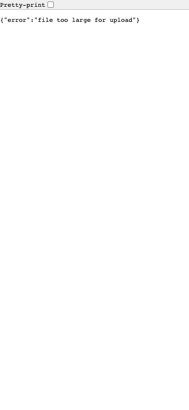
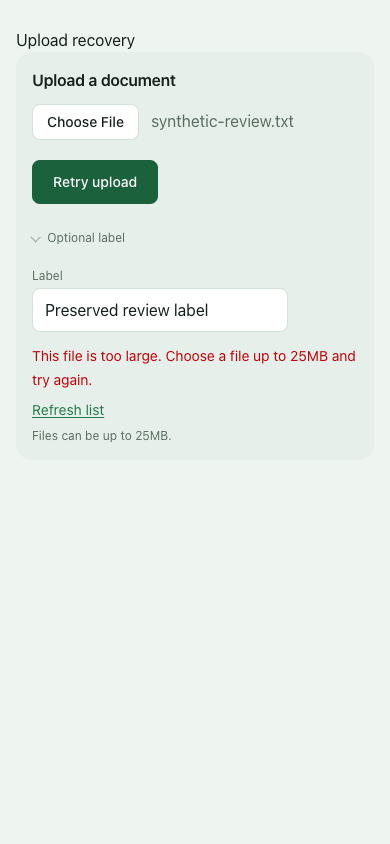

# Upload failure recovery — October 20, 2026

This candidate starts from main `c790625c`, independently of PRs #621, #622 and #624. It addresses the upload error journey shared by Documents and Backstory import. Passage recovery remains a separate frozen candidate.

## Confirmed failure

The shared UploadPanel submitted a native multipart form. Rejected files received a JSON error from the upload endpoint, replacing the page with raw JSON and leaving no form, retry button or return link. The archived main component reproduces this with a controlled local 413 response in four normal/enlarged light/dark profiles. Those browser captures are Documents-specific; Import has the same form behavior and JSON rejection contract in source, rather than a separately executed before capture.

## Bounded behavior change

The enhanced form keeps the current page, selected File object and optional title/label after failure. A readable alert explains the error, Retry upload uses the same preserved input, and Refresh list provides an explicit return path. For an interrupted or unconfirmed result, the message tells the owner to refresh the list before retrying because receipt of a response cannot establish whether the upload completed. No automatic retry occurs.

During a request, the submit button, file and label are disabled. A synchronous guard also rejects repeated submit events before another request can begin. Errors clear when retry starts; the successful response navigates to the existing destination.

Two route handlers add an opt-in transport representation: only an explicit `Accept: application/json` receives `{redirectTo}` after the same accepted upload command. Ordinary native-form success still calls the existing redirect; authentication, module checks, allowed fields, size limits, format handling and storage commands are unchanged. The client accepts only a same-origin destination on the existing Documents, Import or voice-import paths; the server never reads a destination from the submitted form. This avoids following a method-preserving redirect with another multipart POST during enhanced submission.

## Executed checks

The [receipt](assets/upload-recovery-2026-10-20/verification.json) records source and harness hashes, synthetic request fields and every outcome. Twenty actual client-browser journeys exercise both Documents and Import at 390px/root 16px/light and 320px/root 32px/dark. Each profile covers HTTP 400 validation, HTTP 413 size rejection, a controlled disconnected-request error, HTTP 503 with HTML rather than JSON, and HTTP 401. Every journey then retries through native Tab/Return and reaches the representative success destination.

All twenty retain the synthetic file and label after rejection; both attempts contain identical fields and the explicit JSON Accept header. Repeated native `requestSubmit()` while the first response is held adds no request. Pending fields/buttons are disabled. Retry clears the stale alert and success performs a normal page navigation.

Seventy-nine tests pass: 27 helper/route-contract cases plus 52 existing product-fixture checks. Route tests verify enhanced success after the existing command, native success redirect, and invalid-field/signed-out denial under both Accept modes. Helper tests include HTTP 415, unconfirmed HTML/JSON responses, disallowed destinations, and no automatic retry after a transport failure. Local lint and typecheck pass. The generated support matrix changes only the fingerprints of the two upload handlers. Independent QA and exact-head CI remain separate gates.

| Before: raw response | After: retained form and retry | After: confirmed navigation |
| --- | --- | --- |
|  |  |  |

## Limits and replay

Browser checks use the actual UploadPanel, request helper and compiled CSS with a small synthetic file and controlled local responses. They do not execute actual API admission, real size/type validation, authentication, persistence, document processing, provider calls or owner uploads. Network failure is a deterministic browser route abort before the endpoint, distinct from the local HTTP failures. Native fallback contracts are tested with mocked storage commands and the actual handlers; this is not a full native-form production success test.

The enlarged main-base file/label clipping already tracked in PR #621 remains outside this behavior patch. These recovery captures do not recertify whole-page enlarged geometry or apply the separate sizing changes. Successful and error-page screenshots are original captures, not a deployed application claim.

Replay with `pnpm exec tsx scripts/upload-recovery-visual-qa.ts <fresh-output-directory>`. Full final evidence is `.workspace/upload-recovery/final` in the upload-recovery checkout. The archived main before inputs and native form harness are retained under the recorded temporary baseline directory and `/tmp/assistant-upload-main-before*`. Exploratory fixture runs are excluded from the portable receipt.
